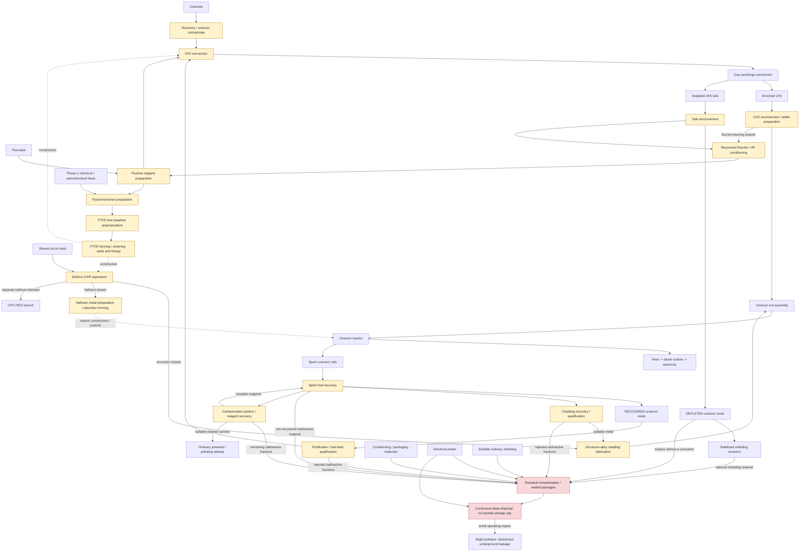
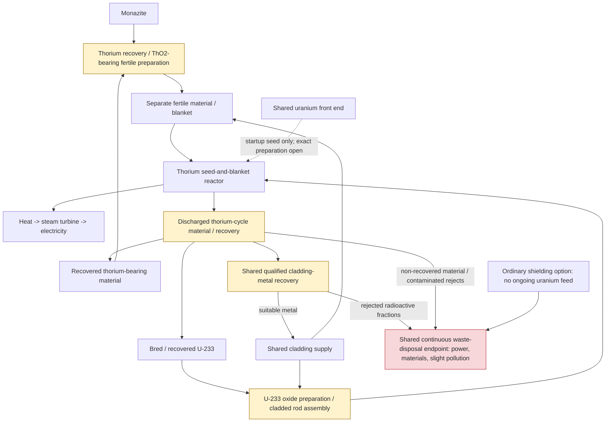

# Power System Design

*Status: Draft — power-route identities, Phase 2 fuel architecture, practical fission baseline, recovery interfaces, and conditioned nuclear-waste endpoint selected; detailed chemistry, construction, numerical balance, and progression gates remain open*
*Last updated: 2026-11-16*

Related documents: [Chemical Products and Processes](chemical-processes.md), [Intermediate Products](intermediate-products.md), [Minerals and Refining](minerals-and-refining.md), [Infrastructure](infrastructure.md), [Endgame Vision](endgame-vision.md). Related ADRs: [ADR-0010](adrs/ADR-0010-core-power-distribution-scope.md), [ADR-0011](adrs/ADR-0011-hawking-radiation-endgame-generator.md), [ADR-0017](adrs/ADR-0017-phase-2-core-and-bridge-prerequisites.md), [ADR-0018](adrs/ADR-0018-phase-3-and-4-power-route-roster-and-conversion.md), [ADR-0019](adrs/ADR-0019-phase-1-and-2-power-progression.md), [ADR-0021](adrs/ADR-0021-phase-2-material-and-solar-boundaries.md), [ADR-0022](adrs/ADR-0022-phase-2-bridge-mappings-and-core-dependencies.md), [ADR-0023](adrs/ADR-0023-thorium-startup-seed-and-breeding-model.md), [ADR-0035](adrs/ADR-0035-powered-polluting-gas-fluid-disposal.md) for gas/fluid disposal power and pollution constraints, [ADR-0036](adrs/ADR-0036-phase-2-minimum-fission-fuel-path.md) and [ADR-0041](adrs/ADR-0041-phase-2-direct-use-fission-fuel.md) for superseded Phase 2 fuel boundaries, [ADR-0038](adrs/ADR-0038-select-phase-2-crystalline-silicon-pv.md) for the initial Phase 2 PV platform and fabrication boundary, [ADR-0039](adrs/ADR-0039-phase-2-lfp-battery-storage.md) for the initial Phase 2 battery chemistry, [ADR-0040](adrs/ADR-0040-phase-2-lfp-feed-sources-and-access.md) for battery feed sources and starting-region access, [ADR-0042](adrs/ADR-0042-require-enriched-phase-2-uranium-fuel.md) for the uranium enrichment requirement, [ADR-0043](adrs/ADR-0043-phase-2-fission-fuel-rod-fabrication.md) for the required Phase 2 rod assembly, [ADR-0044](adrs/ADR-0044-phase-2-shared-zircon-supply-for-fission-cladding.md) for zirconium-alloy cladding and shared zircon access, [ADR-0045](adrs/ADR-0045-phase-2-zirconium-hafnium-separation-stage.md) for the distinct Zr/Hf separation-stage boundary, [ADR-0046](adrs/ADR-0046-select-phase-2-uranium-centrifuge-enrichment.md) for the selected gas-centrifuge enrichment method, [ADR-0047](adrs/ADR-0047-share-phase-2-uranium-chain-with-thorium-seed.md) for the shared uranium-chain source of the thorium startup seed, [ADR-0048](adrs/ADR-0048-select-phase-2-uf6-uranium-fuel-cycle.md) for the high-level UF6-based uranium fuel-cycle forms, [ADR-0049](adrs/ADR-0049-select-phase-2-fluorspar-feed-for-uf6-conversion.md) for the selected fluorspar feed and access timing, [ADR-0050](adrs/ADR-0050-select-phase-2-uraninite-uranium-feed.md) for the selected Uraninite feed and access timing, [ADR-0051](adrs/ADR-0051-defer-phase-2-uranium-enrichment-target.md) for the deferred numeric uranium-fuel target, [ADR-0056](adrs/ADR-0056-share-uranium-fuel-enrichment-grade-with-thorium-seed.md) for the same qualitative grade for the thorium startup seed, [ADR-0057](adrs/ADR-0057-require-phase-2-reprocessing-for-spent-uranium-fuel.md) for required post-discharge reprocessing/recovery of spent uranium fuel, [ADR-0058](adrs/ADR-0058-keep-custom-power-diagnostics-and-stabilization-out-of-core.md) for the Core grid-diagnostics/stabilization boundary, [ADR-0059](adrs/ADR-0059-exclude-blackout-meltdown-gameplay-from-phase-2-core-fission.md) for the Phase 2 Core fission-safety boundary, and [ADR-0060](adrs/ADR-0060-select-phase-2-monazite-thorium-feed.md) for monazite as the thorium feed and its access boundary.

Related fission ADRs: [ADR-0063](adrs/ADR-0063-select-depleted-uranium-oxide-reuse.md) for depleted-oxide reuse, [ADR-0064](adrs/ADR-0064-phase-2-ptfe-bootstrap.md) for PTFE startup, [ADR-0065](adrs/ADR-0065-practical-phase-2-fission-readiness.md) for baseline operability, [ADR-0066](adrs/ADR-0066-select-phase-2-nuclear-recovery-flows.md) for recovery handoffs, and [ADR-0068](adrs/ADR-0068-continuous-nuclear-waste-disposal.md) for continuous, slightly polluting nuclear-solid disposal.

## Summary

This document is the current-state reference for generation routes, energy conversion, storage, fuel-density tradeoffs, and optional transmission. Detailed recipes, material quantities, performance, and progression gates remain open.

## Purpose and Boundaries

- **Core distribution (accepted):** Retain Factorio's vanilla pole grid and add compatible tiered power poles; exact pole tiers and statistics belong in [Infrastructure](infrastructure.md) and remain open.
- **Electric rail load:** Core powered rails must account for real grid power; safe stopping and automatic resumption on outages are selected under [ADR-0073](adrs/ADR-0073-core-electric-only-rail.md). The runtime adapter and its performance remain to be validated in [Logistics System](logistics-system.md).
- **Extension candidate:** A custom transmission system is outside core scope and remains an optional `power-transmission-override` proposal.
- **Progression decisions:** The phase sections below state current design; [ADR-0019](adrs/ADR-0019-phase-1-and-2-power-progression.md) and [ADR-0018](adrs/ADR-0018-phase-3-and-4-power-route-roster-and-conversion.md) preserve the associated decision records.
- **In scope:** Candidate generator phases, fuel-density spectrum, infrastructure needs, power storage, and design questions.
- **Not specified:** Recipe ratios, exact MW/kWh values, machine consumption values, detailed fuel-cycle chemistry and balances, and electrical engineering formulas.

## Core Design Principles for Power Production

1. **Generation choices create tradeoffs, not just raw output.** Compact dense fuels → pollution pressure; clean distributed sources → space pressure; complex supply chains → capital investment.
2. **Every generator class connects to the industrial ecosystem built earlier.** A player who has navigated chemistry, metallurgy, and refining should feel that new generation options are the payoff for that effort.
3. **Fuel density is a primary axis.** The mod's space-pressure design makes fuel-energy-per-unit-volume a meaningful comparison tool across phases.
4. **Progression feels earned but not gated by artificial difficulty.** Each phase opens through capability unlocks (chemical plants, nuclear fabrication, fusion infrastructure), not by making the previous tier too weak to use.
5. **No generator is universally superior.** Tradeoffs exist in resource cost, space footprint, pollution output, maintenance, and supply-chain complexity.

## Four Phases of Power Production

### Phase 1: Combustion (Early Game)

*Accessible from the start; the foundational power mode for every factory.*

| Generator type | Fuel source | Design role | Key tradeoff |
|---|---|---|---|
| Boiler → steam engine (vanilla-style combustion) | Burner-item fuels, including solid fuels and processed fuel items | Foundational early power path; the boiler burns fuel to make steam and the engine converts steam to electricity | Keep the steam engine untiered. Producer gas, biogas, and liquid fuels must be converted to burner items first; no direct gas- or liquid-fuel generator |

**Phase 1 design notes:**
- The core lesson of Phase 1: **fuel density matters.** Processed burner items can carry more energy per item than raw coal, teaching that *how* fuel is refined matters as much as *what* is burned.
- Pollution pressure from dirty combustion routes (unscrubbed sulfur, unfiltered off-gas) creates the first military-pressure driver — connecting power production to the military system.
- The boiler consumes burner items and produces steam; the steam engine consumes steam. Producer-gas and liquid-fuel streams remain fuel-processing outputs and must be converted to burner items before this power path. A gasifier or fuel processor is not itself a generator.
- Photovoltaic generation is not available in Phase 1. Phase 1 generation remains combustion; initial PV and LFP battery storage begin in Phase 2, while an earlier non-battery buffer remains an unselected candidate. The initial PV platform is crystalline silicon on a dedicated Phase 2 route; its silicon grade, process steps, and later efficiency upgrades remain open under [ADR-0038](adrs/ADR-0038-select-phase-2-crystalline-silicon-pv.md). [Bob's Power](https://mods.factorio.com/mod/bobpower) is a precedent for tiered solar and storage; its direct fluid-burning generator path is not adopted.

### Phase 2: Fission (Mid Game)

*Requires Phase 2 Uraninite feed, conversion to uranium concentrate, UF6 conversion, gas-centrifuge enrichment and UO2 reconversion, pellet preparation, cladding, and fuel-rod assembly. The high-level chemical-form sequence is selected under [ADR-0048](adrs/ADR-0048-select-phase-2-uf6-uranium-fuel-cycle.md), and Uraninite and fluorspar feed/access by the conversion unlock are selected under [ADR-0050](adrs/ADR-0050-select-phase-2-uraninite-uranium-feed.md) and [ADR-0049](adrs/ADR-0049-select-phase-2-fluorspar-feed-for-uf6-conversion.md); uranium/fluorite recovery, reagent preparation, detailed chemistry, balances, and research gates remain open. Phase 2 tails handling is required under [ADR-0052](adrs/ADR-0052-require-phase-2-depleted-uf6-tails-handling.md); deconversion to uranium oxide and HF is selected under [ADR-0053](adrs/ADR-0053-select-depleted-uf6-deconversion.md); uranium oxide is recovered for later uranium use and HF for reuse in UF6 conversion under [ADR-0054](adrs/ADR-0054-select-depleted-uf6-output-fates.md); exact forms, conditioning, and process integration remain open. The numeric uranium-fuel enrichment target is deferred under [ADR-0051](adrs/ADR-0051-defer-phase-2-uranium-enrichment-target.md) until detailed recipe and balance design.*

| Generator type | Fuel source | Design role | Key tradeoff |
|---|---|---|---|
| Uranium fission reactor | Uraninite -> uranium concentrate -> UF6 conversion -> gas-centrifuge enrichment -> enriched UF6 -> UO2 pellets -> cladded fuel rods under [ADR-0048](adrs/ADR-0048-select-phase-2-uf6-uranium-fuel-cycle.md) | Enriched-uranium cycle for dense, sustained power | Requires Uraninite/fluorspar supply, cladding, rod fabrication, heat removal, tails deconversion, and spent-fuel recovery. Depleted oxide has shielding reuse and controlled surplus handling; recovered spent-fuel uranium returns through the qualified fuel front end. Recovery destinations are selected under [ADR-0066](adrs/ADR-0066-select-phase-2-nuclear-recovery-flows.md); detailed chemistry, conditioning, and balances remain open |
| Thorium seed-and-blanket reactor | Monazite-derived Th-232 -> separate ThO2-bearing fertile material, with a uranium-derived startup seed from the shared uranium chain; bred U-233 returns as oxide rods under [ADR-0055](adrs/ADR-0055-select-phase-2-thorium-oxide-seed-blanket-architecture.md) | Th-232 is fertile, not fissile; the startup driver enables the separate breeding/reprocessing cycle | Monazite must be accessible by the route unlock without a starting-region guarantee under [ADR-0060](adrs/ADR-0060-select-phase-2-monazite-thorium-feed.md). The seed shares uranium fuel's qualitative enrichment grade under [ADR-0056](adrs/ADR-0056-share-uranium-fuel-enrichment-grade-with-thorium-seed.md); exact composition and quantities remain open. No continuous uranium top-up is required in the gameplay abstraction, including through waste packaging. Thorium/U-233 recovery and residual handling are selected below; no real-world self-sustaining breeding ratio is implied. See the [thorium overview](https://world-nuclear.org/information-library/current-and-future-generation/thorium) |
| Solar photovoltaic (crystalline-silicon PV) + LFP battery storage | Sunlight; dedicated Phase 2 PV production route based on the selected silicon supply direction; LFP cells for battery storage | Clean, fuel-free supplement with day/night variability | PV and battery storage begin in Phase 2; initial PV does not depend on the CPU wafer/chip fabrication chain or post-Core-only capability. PV-specific cleanliness, equipment, and any shared upstream silicon processing remain open. The starting region guarantees apatite-rich phosphorite and lithium-bearing brine; spodumene remains an alternative and may be regional under [ADR-0040](adrs/ADR-0040-phase-2-lfp-feed-sources-and-access.md). Exact silicon grade, cell process, feed-recovery routes, cell/pack design, unlocks, capacity, and tiers remain open under [ADR-0038](adrs/ADR-0038-select-phase-2-crystalline-silicon-pv.md), [ADR-0039](adrs/ADR-0039-phase-2-lfp-battery-storage.md), and [ADR-0040](adrs/ADR-0040-phase-2-lfp-feed-sources-and-access.md) |

**Current phase direction:** Introduce fission in Phase 2 as two distinct uranium and thorium-cycle options. Retain the steam-turbine conversion path through Phase 2 to use fission heat-exchanger steam; retire steam-turbine generation after Phase 2. Phase 1 combustion remains usable. PV begins no earlier than Phase 2 and remains a clean, space-intensive option rather than a Phase 1 bypass. Its initial crystalline-silicon platform uses a dedicated route independent of CPU wafer/chip fabrication and post-Core-only capability under [ADR-0038](adrs/ADR-0038-select-phase-2-crystalline-silicon-pv.md).

Both Phase 2 fission options require zirconium-alloy cladding and fuel-rod assembly under [ADR-0043](adrs/ADR-0043-phase-2-fission-fuel-rod-fabrication.md) and [ADR-0044](adrs/ADR-0044-phase-2-shared-zircon-supply-for-fission-cladding.md). Shared early/mid-Phase-2 zircon supply feeds a distinct Zr/Hf separation stage under [ADR-0045](adrs/ADR-0045-phase-2-zirconium-hafnium-separation-stage.md), serving cladding, CPU hafnium, and baseline hafnium absorbers. Detailed separation chemistry, metal preparation, alloying, grades, quantities, and equipment assignments remain open.

The uranium chain and thorium startup seed retain their shared qualitative enrichment grade; the numeric target remains deferred under [ADR-0051](adrs/ADR-0051-defer-phase-2-uranium-enrichment-target.md) and applies to both under [ADR-0056](adrs/ADR-0056-share-uranium-fuel-enrichment-grade-with-thorium-seed.md). Exact seed compound, isotope composition, item identity, quantity, preparation, and detailed breeding/reprocessing chemistry and balances remain open.

#### Phase 2 Startup and Material Handling

- **Core capability, optional power choice:** First fission is a usable, normally automated plant with Phase 2 hafnium preparation/forming and ordinary fuel handling under [ADR-0065](adrs/ADR-0065-practical-phase-2-fission-readiness.md). Later precision equipment, superconductors, boron-carbide alternatives, and beryllium reflectors are not universal startup prerequisites.
- **Acyclic startup:** Boiler/steam-engine power can run the initial supply chain. First PTFE, including its fluorine/monomer preparation and construction-product finishing, must be available without PTFE-built equipment or recovered nuclear HF under [ADR-0064](adrs/ADR-0064-phase-2-ptfe-bootstrap.md). First nuclear buildings must also have suitable ordinary shielding, rather than require their own depleted-oxide coproduct.
- **Required back end:** The chosen route's recovery and residual-handling capabilities must be available in Phase 2 by first production of the corresponding streams. These are not extension-only capabilities or evidence of a numerically balanced cycle.

| Stream | Selected handling |
|---|---|
| Depleted oxide from UF6 tails | Stabilized shielding ceramics under [ADR-0063](adrs/ADR-0063-select-depleted-uranium-oxide-reuse.md); optional military uses are not a required sink. Surplus enters conditioned terminal handling |
| Uranium recovered from spent uranium fuel | Recovered oxide -> purification/requalification -> existing conversion/enrichment front end -> qualified oxide fuel and rods; no direct spent-to-fresh recipe |
| Recovered thorium and bred/recovered U-233 | Return thorium to fertile-material preparation and U-233 through oxide-fuel preparation and cladded rod assembly; preserve the startup-only uranium dependency |
| Recoverable cladding and fluorine-bearing streams | Qualify metal before metallurgy/fabrication reuse; recover and condition fluorine from both UF6 branches for reagent reuse, retaining fresh startup/makeup |
| Radioactive residues, contaminated recovery rejects, and surplus depleted oxide | Immobilization -> suitable sealed packages -> continuous deep disposal under [ADR-0068](adrs/ADR-0068-continuous-nuclear-waste-disposal.md), consuming power/materials and producing slight pollution; no tracked storage cap |

[ADR-0066](adrs/ADR-0066-select-phase-2-nuclear-recovery-flows.md) selects the recovery interfaces. Depleted oxide, recovered spent-fuel oxide, and qualified enriched fuel are distinct roles, not interchangeable grades. No lossless cycle, separate plutonium product, MOX route, or mandatory ammunition link is selected.

Continuous deep disposal is a narrow terminal exception for conditioned nuclear solids, not a generic solid voider. It has no tracked lifetime storage capacity or permanent-cell expansion. Throughput, electrical power, and conditioning/packaging material supply constrain operation. A small, nonzero operating pollution cost represents abstracted underground leakage/environmental impact using the ordinary pollution system, not a new groundwater or accident simulation.

Nuclear-bearing effluents retain radioactive fractions for recovery/conditioning; generic flares and clarifiers cannot erase them. Ordinary shielding remains available for all waste packaging, so thorium does not require ongoing uranium enrichment. Loss of power/materials pauses processing rather than creating a permanent containment-power or blackout-failure loop. Ultimate underground capacity is deliberately outside the model; the waste is disposed of, not recycled or physically destroyed. Package chemistry, cooling/buffers, exact entities, throughput, operating inputs, small emission rate, and gates remain open.

#### Fuel Production and Recovery Diagrams

These are capability/material-role diagrams, not balanced recipes. Orange nodes have selected roles but unresolved chemistry, qualification, equipment details, or quantities. Dashed arrows mark construction or startup dependencies, not continuous fuel consumption. The thorium diagram reuses the shared fabrication and residual-handling capabilities shown in the uranium diagram.

Recovered uranium still needs conversion/enrichment and qualification; depleted oxide is not that recovered-fuel stream. Shielding demand is useful but finite, so surplus depleted oxide retains continuous disposal without a storage cap. Recovery never implies zero residues. The thorium loop's startup-only uranium dependency is a gameplay abstraction, not a proven real-world breeding balance. Independent zirconium/hafnium demands and every numerical material, energy, recovery-loss, disposal-throughput, and pollution balance remain to be validated.

**Phase 2 design notes:**
- Fission power density should be **orders of magnitude higher** than combustion, creating massive spatial relief for the factory. Fabrication remains substantial; the baseline hafnium-control capability is selected, while exact vessel/moderator materials and optional absorber variants remain configuration choices.
- Fission heat must pass through the Phase 2 heat-to-steam path; exact heat-exchanger and coolant details remain open. Core excludes blackout-induced meltdown gameplay and a dedicated emergency-safety device under [ADR-0059](adrs/ADR-0059-exclude-blackout-meltdown-gameplay-from-phase-2-core-fission.md).
- Phase 2 fission converts heat through steam turbines. The exact turbine removal point is after Phase 2, not before fission is introduced.
- The baseline uranium route requires enriched UO2 pellets under [ADR-0042](adrs/ADR-0042-require-enriched-phase-2-uranium-fuel.md), then Phase 2 cladding and rod assembly. Both fission options depend on those fabrication capabilities under [ADR-0043](adrs/ADR-0043-phase-2-fission-fuel-rod-fabrication.md); the shared zircon path includes a distinct Zr/Hf separation stage under [ADR-0045](adrs/ADR-0045-phase-2-zirconium-hafnium-separation-stage.md). Fuel-form details, zirconium-alloy grade, zircon feed preparation/conversion, separation chemistry/equipment, alloying and rod-forming routes, combined supply quantities, conversion/reprocessing steps, material balances, equipment assignments, and research gates remain open.
- Neither uranium nor thorium fuel is a first-Core prerequisite; a fission path is required only when selected to supply power. The thorium startup model is selected in ADR-0023, with the seed sourced from the shared uranium chain under ADR-0047; the solid-oxide seed-and-blanket architecture is selected under [ADR-0055](adrs/ADR-0055-select-phase-2-thorium-oxide-seed-blanket-architecture.md); exact seed details and the fuel-route balance remain open.
- Exact normal operating controls, monitoring, coolant routing, reactor tiers, and research gates remain open; the Core boundary does not add a separate blackout-failure loop.
- Fission can create **breathing room from military pressure** if operated cleanly. Reactor generation avoids combustion exhaust, but fuel preparation, recovery, and waste handling may still have pollution costs; their values remain open.

### Phase 3: Fusion (Late Game)

*Requires fusion fuel infrastructure; connects to the deepest mining and chemistry of the mod.*

| Generator type | Fuel source | Design role | Key tradeoff |
|---|---|---|---|
| Tokamak-class D-T fusion reactor | Deuterium (from water electrolysis/concentration) + tritium (bred from a lithium blanket) | Selected Phase 3 route; a Tokamak is itself a magnetic-confinement design | Deep industrial chain and large construction cost; fuel availability depends on tritium breeding and blanket operation |
| Geothermal generation | Heat from a geothermal reservoir | Selected Phase 3 route; location-dependent, non-fusion baseload | Steady output where suitable sites exist; map placement and extraction limits remain open |
| Solar PV scale-up | Sunlight; progressively improved photovoltaic materials | Selected Phase 3 route continuing early photovoltaic generation | Clean and fuel-free, but land- and storage-intensive; later material tiers remain proposed |
| Concentrated solar thermal + storage | Sunlight concentrated into stored high-temperature heat; sodium/potassium nitrate salts are a material candidate for storage | Selected additional Phase 3 route; dispatchable thermal generation | Requires a non-steam high-temperature converter; overlaps PV's space trade-off, while the salt blend and site design remain open |

**Phase 3 design notes:**
- **Selected minimum roster:** Tokamak, geothermal generation, and continued solar PV. Concentrated solar thermal with storage is an additional selected route. Their exact construction chains, relative outputs, and unlocks remain open.
- **Startup gap:** A source for the first tritium and a viable lithium-breeding/recovery loop are not selected. Phase 5 must demonstrate startup without assuming an unfueled Tokamak can breed its own initial fuel.
- “Magnetic confinement” is a category that includes the Tokamak, not a second generator. The design does not count a generic magnetic-confinement or inertial-fusion concept as another Phase 3 option. Tokamaks and stellarators are magnetic-confinement approaches; see the [World Nuclear Association fusion overview](https://world-nuclear.org/information-library/current-and-future-generation/nuclear-fusion-power).
- Fusion fuel is **effectively infinite**: deuterium from water, tritium bred from lithium. The constraint is not fuel supply but *infrastructure*.
- The fusion chain touches more parts of the mod than any other single capability: mining (tungsten, niobium/tantalum, lithium), chemistry (deuterium concentration, lithium processing), metallurgy (superconducting alloys, plasma-facing tungsten), and semiconductor electronics (magnet control systems).
- Fusion should be **the ultimate spatial relief** — a small footprint delivering enormous power. However, building the first fusion reactor should feel like a major project rivaling the endgame Core in scope.

### Phase 3–4 Power Conversion Boundary (Selected Architecture; Details Open)

Steam-based conversion ends after Phase 2. Phase 3/4 heat sources use closed non-steam conversion systems; this is a design boundary, not a claim that high-temperature heat cannot produce steam in engineering. The selected converter families match the source temperature and connect to distinct material chains:

| Converter | Selected application | Material and process hooks | Trade-offs and limits |
|---|---|---|---|
| Closed supercritical-CO₂ Brayton cycle | High-grade heat from the Tokamak and concentrated-solar receiver/storage | A sealed, pressurized CO₂ loop drives a compact turbine/recuperator rather than a water-steam turbine. Hot-side parts can connect to nickel/chromium/cobalt superalloys, refractory linings, and high-pressure heat-exchanger alloys. MIT's reactor-cycle analysis treats the cycle as suitable for high-temperature heat sources above roughly 500°C. | Requires a sufficiently hot source, high-pressure containment, and demanding seals/heat exchangers. CO₂ is a recirculated working fluid, not a fuel. |
| Binary organic Rankine cycle (ORC) | Lower- or medium-temperature geothermal heat | Geothermal brine heats a separate sealed, lower-boiling working fluid (for example, an isobutane- or pentane-family fluid); only that vapor passes through the expander. Titanium or stainless-steel heat exchangers connect to corrosion-resistant materials and existing hydrocarbon chemistry. | It is non-steam, but still a closed vapor-expansion cycle; the chosen fluid brings flammability, leakage, and environmental trade-offs. DOE describes binary geothermal plants as using a secondary fluid that never contacts the geothermal turbine. |
| Thermophotovoltaic (TPV) receiver | Phase 4 Hawking route, after radiation is absorbed into a controlled high-temperature emitter | Thermal infrared photons generate electricity directly in bandgap-matched III–V cells, with a tungsten emitter and reflective spectral-return surfaces. The material hooks include gallium, indium, arsenic, and tungsten, linking late power conversion to semiconductor and refractory chains. | Laboratory TPV cells have exceeded 40% efficiency at emitter temperatures of 1,900–2,400°C; this is an emerging technology, not a mature utility-scale plant. A controlled emitter spectrum and cell cooling are required; do not assume direct conversion of unfiltered Hawking radiation. |

Other Phase 3/4 routes do not need a heat engine: solar PV and the stellar-scale collector use photovoltaic conversion, with the energy beam serving only as transmission; the cross-universe route uses a speculative direct field coupler rather than a thermal cycle. Exact working fluids, alloy grades, storage salts, efficiencies, cooling systems, and converter construction chains remain open. Sources: [MIT supercritical-CO₂ cycle analysis](https://dspace.mit.edu/handle/1721.1/17746), [DOE geothermal binary-cycle overview](https://www.energy.gov/hgeo/geothermal/geothermal-electricity-generation), and [Nature thermophotovoltaic demonstration](https://doi.org/10.1038/s41586-022-04473-y).

### Phase 4: Near-Realistic Sci-Fi Endgame Power Generation

*The relationship between Phase 4 generation and an active Planetary Simulation Core, including its unlock gate, remains open.*

The Phase 4 roster includes three selected route identities; see the table below. The Subspace Capacitor is not selected; see [ADR-0011](adrs/ADR-0011-hawking-radiation-endgame-generator.md). Detailed mechanics, research gates, relationship to the Core, and whether each route is optional or required remain open.

| Generator concept | Principle | Design role | Key tradeoff |
|---|---|---|---|
| Hawking Radiation Engine | Contained micro-black hole emitting Hawking radiation; harvested via a controlled thermal emitter | Selected as one of three Phase 4 options. TPV is the selected conversion direction after radiation is absorbed and spectrally matched to a high-temperature emitter; finite lifetime and a Core role remain proposals | Large construction demand, source spectrum, emitter temperature, containment, and lifetime are unresolved; the black-hole source itself is speculative |
| Cross-universe exergy-gradient tap | A controlled boundary couples to an external non-equilibrium energy reservoir; work is extracted while entropy rises on the source side | Selected Phase 4 route identity; the usable source is the cross-boundary energy gradient, not “entropy” as a fuel | Must define a finite or constrained source, boundary stability, and consequences in the donor universe; not established physics. It uses a direct field-coupling concept, not a heat engine |
| Stellar-scale solar collection + energy beam | Large-scale solar collectors generate electricity; a beam transfers it to remote receivers | Selected Phase 4 route identity; the collector is photovoltaic generation at stellar scale, while the beam is transmission | Space-based collection and receiver infrastructure are complex. Space Exploration's [Energy Beam](https://spaceexploration.miraheze.org/wiki/Energy_Beam) sends energy to receivers as heat and includes distance losses; the beam is not a separate generator |

**Reserve concepts for review, not counted toward the three-route minimum:**
- **Rotating black-hole energy extraction:** tap a rotating black hole's spin rather than its Hawking radiation. It is a distinct theoretical mechanism but shares extreme black-hole containment and overlaps the Hawking route thematically.
- **Antimatter annihilation:** a high-density energy carrier used in science fiction, but not a net primary source if the factory must spend more energy creating it than it later recovers. It only becomes a distinct power route if its source and energy balance are defined.

**Hawking Radiation Engine — provisional implementation concept:**
- **Construction phase (massive power investment):** Player builds an optical concentrator array (precision glass/mirror elements from optics chain) that collapses a concentrated radiation field into a micro-singularity. This requires enormous input power to achieve the threshold for radiation-pressure collapse. Ironic cycle: you need more power to build it than it produces initially — but once stable, output exceeds construction draw.
- **Operational phase (finite but extendable):** The contained micro-black hole emits Hawking radiation at a predictable spectrum (computed by the Planetary Simulation Core). The selected conversion direction absorbs that radiation into a controlled high-temperature emitter for TPV cells; the spectrum and thermal-management model remain unvalidated. Without replenishment, the black hole loses mass as it radiates; its theoretical lifetime increases strongly with initial mass, while gameplay lifetime remains open.
- **Feeding matter to extend life:** Player can feed concentrated matter/fuel into the singularity (mass → energy via E=mc²). This extends operational life but costs resources: you trade material inputs for power output at a predictable rate. Different fuel types have different mass-energy yields, connecting back to the fuel-density spectrum.
- **Smaller = faster evaporation:** A smaller initial black hole has a higher Hawking temperature and evaporates faster. The resulting TPV efficiency depends on the emitter and conversion design and remains unvalidated; a size-versus-lifetime gameplay tradeoff is a candidate.
- **Simulation's role:** Computes Hawking radiation spectrum for thermal converter optimization, models collapse dynamics during construction to prevent containment breach, predicts remaining lifetime based on feeding schedule.

**Candidate player education — informatron/guidebook entries:**
- The Phase 4 candidate may have a **dedicated physics page** in the player's guidebook (informatron or equivalent). It would explain the underlying science at increasing levels of depth:
  - **Fission entry:** How nuclear binding energy works, why splitting heavy nuclei releases energy, mass defect → E=mc², chain reactions, why the selected uranium route uses enrichment, and how requirements vary by reactor design
  - **Fusion entry:** How light nuclei fusion overcomes Coulomb barrier, binding energy curve peak near iron-56, why extreme temperature/pressure needed, magnetic confinement principles, the D-T reaction
  - **Phase 4 option:** Hawking radiation as a result of quantum field theory in curved spacetime, with an accessible explanation of particle pairs near an event horizon.
- The guidebook doesn't assume prior physics knowledge but rewards players who engage with the deeper explanations. Early-game summaries explain *what* happens; advanced entries explain *why* — accessible to any player willing to read.

**Open design details for Phase 4:**
- The generator would be player-built rather than found as a pre-made power source.
- The Planetary Simulation Core would provide operational or construction value beyond a research unlock.
- Simulation would inform construction or operation without replacing material constraints.
- The generator would be optional and would not be required for victory.

Hawking is accepted as one Phase 4 option under [ADR-0011](adrs/ADR-0011-hawking-radiation-endgame-generator.md); the boundary between advanced fusion and Phase 4, route gates, and alignment with [Endgame Vision](endgame-vision.md) remain open.

## Fuel Density Spectrum (Reference Guide)

The mod's space-pressure design makes fuel density a critical comparison axis. This table organizes candidate fuels by energy-per-unit-volume, mapped to their game-phase and industrial connections:

| Phase | Fuel candidate | Source chain connection | Relative density |
|---|---|---|---|
| 1 (combustion) | Wood / biomass | Biomass processing or plant matter | Very low |
| 1 (combustion) | Charcoal / carbonized biomass | Carbonization from raw biomass | Low |
| 1 (combustion) | Coke / processed carbon | Coal carbonization | Medium |
| 1 (combustion) | Coal (raw mined) | Surface or underground mining, Tier 1–2 deposit | Medium-high |
| 1 (combustion) | Producer gas (coal gasification) | Bosch-Messig / Lurgi coal gasifier + steam/air | Medium (volumetric; gaseous fuel has inherent density limits) |
| 1→2 transition | Crude oil / refined hydrocarbon fuels | Oil extraction, fractionation, catalytic cracking | High — liquid fuels dominate the density axis |
| 1→2 transition | Fischer-Tropsch synthetic fuels (gasoline/diesel/paraffin) | Coal gasification → syngas → FT synthesis | High — bridges coal to high-density fuel when oil is unavailable |
| 2 (fission) | Enriched UO2 fuel rods | Uraninite -> uranium concentrate -> UF6 conversion using fluorspar, with feeds/access selected under [ADR-0050](adrs/ADR-0050-select-phase-2-uraninite-uranium-feed.md) and [ADR-0049](adrs/ADR-0049-select-phase-2-fluorspar-feed-for-uf6-conversion.md) -> gas-centrifuge enrichment under [ADR-0046](adrs/ADR-0046-select-phase-2-uranium-centrifuge-enrichment.md) -> pellet preparation -> Phase 2 cladding and rod assembly; recovery, conversion chemistry, equipment, and balance remain open | Extreme — orders of magnitude above combustion fuels |
| 2 (fission, optional) | Bred U-233 | Thorium oxide seed-and-blanket cycle | Extreme — alternative long-horizon fuel |
| 3 (fusion) | Deuterium + tritium (D-T) | Water concentration → deuterium; lithium breeder → tritium | Extreme — near-infinite supply, requiring infrastructure not fuel extraction |

**Key insight:** The progression from Phase 1 to Phase 2 is a **~10,000x density jump**. This makes the spatial relief of nuclear power profound and should be communicated through factory-scale comparison (one reactor replacing dozens of generators). Phase 3's advantage is not just more power — it's *sustainable* dense power with effectively infinite fuel.

## Infrastructure Hooks per Generator Class

### Combustion Generators
- **Boiler → steam engine:** The boiler burns a burner item to produce steam; the untiered steam engine consumes steam to generate electricity. This follows the vanilla conversion boundary.
- **Gas and liquid fuel preparation:** Producer gas, biogas, and liquid fuels are not fed directly to generators. Any power-bound stream must first be converted to a burner item; the gasifier or fuel processor is not a generator.
- **Phase 2 steam turbine:** Retained through Phase 2 as the fission heat-to-electricity converter, then retired from the progression.

### Fission Generators

The minimum capabilities above are selected; detailed construction and equipment implementations below remain candidates unless explicitly stated. [Infrastructure](infrastructure.md) owns equipment scope; the Phase 2 fission routes must not depend on equipment available only in later game phases.

#### Reactor Core Assembly

| Component | Infrastructure Source | Power Requirements | Design Notes |
|-----------|----------------------|-------------------|--------------|
| Pressure vessel shell | Candidate refractory steel panels and zirconium cladding | Candidate welding and inspection equipment; power needs open | High-pressure coolant containment; reactor tiers remain open |
| Graphite moderator blocks | Candidate graphite from carbon processing | None directly, but thermal management is important | Candidate neutron moderation and servo-controlled spacing |
| Hafnium control rod assemblies | Phase 2 hafnium metal preparation and basic absorber forming | Normally automated baseline controls; exact mechanism and power needs open | Selected baseline capability under [ADR-0065](adrs/ADR-0065-practical-phase-2-fission-readiness.md); boron carbide remains an optional alternative, not a co-required input |

#### Fuel Fabrication Chain — Parallel Supply Line

| Sub-component | Candidate Route or Equipment | Power Needs | Design Notes |
|--------------|----------------------|-------------|--------------|
| Uranium Conversion Line | Conversion → gas-centrifuge enrichment under [ADR-0046](adrs/ADR-0046-select-phase-2-uranium-centrifuge-enrichment.md) → UO2 powder → Phase 2 pellet preparation; feed/conversion chemistry and equipment split remain open | Candidate electrical loads for pumps, heaters, and agitators; exact power needs open | Parallel chain from minerals-and-refining through chemistry; enriched UO2 is required under [ADR-0042](adrs/ADR-0042-require-enriched-phase-2-uranium-fuel.md) |
| Fuel Pellet Sintering Furnace | Candidate refractory construction | Phase 2 pellet-preparation capability; exact equipment assignment and power draw remain open | Produces enriched UO2 pellets as an intermediate for the required rod-assembly route; an integrated process or different equipment split remains possible |
| Cladding Tube Mill | Candidate zirconium-alloy tube extrusion + pilger rolling | Phase 2 minimum capability for both fission options under [ADR-0043](adrs/ADR-0043-phase-2-fission-fuel-rod-fabrication.md); zirconium-alloy family and shared zircon access selected under [ADR-0044](adrs/ADR-0044-phase-2-shared-zircon-supply-for-fission-cladding.md); a distinct Zr/Hf separation stage is required under [ADR-0045](adrs/ADR-0045-phase-2-zirconium-hafnium-separation-stage.md) | Produces fuel-rod cladding; exact feed recovery/conversion, separation chemistry and equipment, alloy grade and fabrication route, supply quantities, and build details remain open |
| Fuel Rod Assembly Line (MTier 1-3 candidate) | Item-fed baseline batch assembly; later handling and inline-inspection upgrades | Usable Phase 2 minimum under [ADR-0043](adrs/ADR-0043-phase-2-fission-fuel-rod-fabrication.md) and [ADR-0065](adrs/ADR-0065-practical-phase-2-fission-readiness.md); exact tiers and gates remain open | No compulsory per-pellet player actions; detailed welding, testing, and inspection implementation remains open |
| Zr/Hf Separation Plant | Candidate implementation of the distinct separation stage selected under [ADR-0045](adrs/ADR-0045-phase-2-zirconium-hafnium-separation-stage.md) | Exact equipment and power requirement remain open | Separates the shared zircon path into zirconium-bearing and hafnium-bearing streams for cladding and CPU/fission uses; chemistry, output forms, yields, and dedicated-entity status remain open |

#### Waste Handling & Maintenance
- Phase 2 recovery and waste interfaces are selected in the [startup and material-handling section](#phase-2-startup-and-material-handling). Detailed chemistry, equipment split, and any cooling/buffer implementation remain open; no particular spent-fuel pool is selected.
- Conditioned nuclear solids use suitable sealed packages and continuous deep disposal with power/material costs, slight pollution, and no tracked storage cap. Ordinary-shielding alternatives keep thorium independent of ongoing uranium. Required recovery and disposal are Core capabilities, not optional-extension substitutes; plutonium extraction and mandatory military demand are not selected.
- Core fission-safety scope excludes blackout-induced meltdown gameplay and a dedicated Dead-Battery Capacitor / Fuse Link under [ADR-0059](adrs/ADR-0059-exclude-blackout-meltdown-gameplay-from-phase-2-core-fission.md); exact normal controls and heat-management details remain open.

### Fusion Generators

The Tokamak needs a heat-to-electricity system; it does not deliver raw plasma as grid power. The selected non-steam direction is a closed supercritical-CO₂ Brayton cycle for high-grade heat. The reactor's achievable outlet temperature and the converter's materials and construction requirements remain open.

The following components and equipment are candidates. Phase 4+ specialist equipment in [Infrastructure](infrastructure.md) is not a prerequisite for the selected Phase 3 Tokamak; a phase-compatible construction and fuel path must be established during later scope and coverage work.

| Component | Candidate Infrastructure | Power Requirements | Design Notes |
|-----------|----------------------------------|-------------------|--------------|
| Tungsten Plasma-Facing Armor Tiles | Phase 4+ Tungsten Armor Tile Molder is a candidate; initial Phase 3 fabrication remains open | Pre-assembly heating during fabrication; no operational power draw | Candidate high-material-demand construction using sintered tungsten |
| Nb₃Sn/NbTi Superconducting Magnet Coils | Candidate Coil Winding Machine; exact tiers and gates open | Cryogenic cooling during operation; exact load open | Candidate niobium + tin/titanium processing and insulated winding |
| Lithium Breeder Blanket Panels | Phase 4+ Lithium Breeder Blanket Panel Assembler is a candidate; initial Phase 3 fabrication remains open | Candidate lithium circulation and coolant-loop pumps | Connects to mineral refining and lithium processing; exact panel construction remains open |
| Deuterium Concentration Facility | Candidate membrane cells and electrolyzer; process and equipment remain open | Candidate sustained electrical input for separation | Candidate concentration cascade from water to fusion-grade D₂ |
| Tokamak Vacuum Vessel Assembly | Phase 4+ Extreme-Pressure Containment Vessel Assembler is a candidate; initial Phase 3 fabrication remains open | Candidate welding and inspection; power needs open | Candidate multi-layer vessel fabrication; material and assembly steps remain open |

### Endgame Physics-Driven Generators

#### Hawking Radiation Engine — Construction Infrastructure

The selected thermophotovoltaic conversion direction and candidate construction capabilities are shown below. [Infrastructure](infrastructure.md) owns equipment scope; exact construction requirements remain open.

| Component or Capability | Candidate Equipment | Phase | Power Requirements | Role in Engine |
|-----------|-------------------|-------|-------------------|----------------|
| Precision optics | Candidate Precision Optics Fabrication Station; equipment and cleanliness needs open | Construction | Candidate servo and fabrication loads; exact power needs open | Candidate lenses, mirrors, and interferometers for an optical concentrator |
| Extreme-pressure containment | Candidate containment-vessel assembly; equipment and tiers open | Construction | Candidate welding and inspection loads; exact power needs open | Candidate multi-layer containment shells |
| Thermophotovoltaic conversion | Controlled high-temperature emitter and TPV receiver; constructables and materials open | Operation | Generates power compatible with the vanilla grid; cooling requirements open | Converts emitter radiation to electricity using the selected TPV direction under [ADR-0018](adrs/ADR-0018-phase-3-and-4-power-route-roster-and-conversion.md) |
| Superconducting magnetic containment | Candidate coil winding and superconducting wire; equipment and materials open | Construction → operation | Candidate winding and cryogenic-cooling loads; exact power needs open | Candidate containment field for the singularity |

The construction entries are candidates, not current recipe requirements; exact inputs and quantities remain open.

## Open Design Decisions (Power Production)

- **Which Phase 3/4 non-steam conversion details remain?** The selected directions are closed supercritical-CO₂ Brayton for high-grade heat, binary organic Rankine for geothermal heat, and TPV for the Hawking-route emitter. Exact source conditions, materials, working fluids, performance, and construction details remain open.
- **Which Phase 2 fission operating details remain?** The Core excludes blackout-induced meltdown gameplay and a dedicated emergency-safety device under [ADR-0059](adrs/ADR-0059-exclude-blackout-meltdown-gameplay-from-phase-2-core-fission.md); exact normal heat-transfer, coolant, controls, monitoring, tiering, and research/construction gates remain open.
- **How is the selected monazite feed processed for the thorium blanket?** Monazite is the Phase 2 Th-232 feed family, with limited supply accessible by the thorium power-route unlock under [ADR-0060](adrs/ADR-0060-select-phase-2-monazite-thorium-feed.md). Exact output form, recovery/separation chemistry, residue handling, grades, quantities, and balances are deferred to detailed product and recipe design after Phase 5 coverage; equipment and research assignments remain for their owning design phases. A starting-region monazite deposit is not required.
- **Which fuel-processing routes produce burner items?** The vanilla boiler/steam-engine path is selected, but the exact item forms and processing paths for producer gas, biogas, and liquid fuels remain open.
- **What fission fuel-cycle details remain open?** The feed/form sequences, rod requirement, recovery interfaces, oxide reuse, and continuous residual-disposal endpoint are selected above. Detailed feed recovery, reagent/monomer preparation, conversion and separation chemistry, recovered-fuel qualification, oxide/HF forms, alloy and absorber grades, seed identity/composition/preparation, breeding/reprocessing implementation, equipment split, and research gates remain open. Numerical enrichment targets, yields, losses, combined feed demand, energy/material costs, disposal throughput, and slight pollution rates remain deferred; the eventual uranium-fuel target also applies to the thorium startup seed.
- **How does fusion connect to later endgame progression?** Fusion begins in Phase 3 and cannot be a first-Core prerequisite; its relationship to later Core levels and milestones remains open.
- **What are the remaining solar material and storage gates?** The initial Phase 2 platform is crystalline silicon on a dedicated route independent of CPU wafer/chip fabrication and post-Core-only capability under [ADR-0038](adrs/ADR-0038-select-phase-2-crystalline-silicon-pv.md); initial Phase 2 battery cells use LFP cathode chemistry under [ADR-0039](adrs/ADR-0039-phase-2-lfp-battery-storage.md), with feed sources and starting-region access selected under [ADR-0040](adrs/ADR-0040-phase-2-lfp-feed-sources-and-access.md). Exact silicon grade, shared upstream processing, PV-specific cleanliness and equipment, lithium/phosphate recovery routes/grades, spodumene placement/access timing, cell/pack design, unlocks, capacities, later tiers, site design, efficiencies, and research gates are deferred to downstream design. Phase 5 coverage must verify viable PV and LFP supply paths before catalog freeze; preserve the selected feeds and access, and do not make cobalt or nickel necessary for the initial LFP route. The Phase 3 PV scale-up and additional CSP-with-storage route are selected.
- **How should geothermal sites work?** The Phase 3 geothermal route and binary ORC direction are selected, but site placement, resource limits, working fluid, and heat-exchanger design remain open.
- **How much does each generator class contribute to military pressure?** Clean combustion (scrubbed) vs. dirty combustion; fission's thermal pollution; fusion's zero-emission profile — these affect the player's decision calculus.
- **How are the selected recovery and terminal interfaces implemented?** Phase 5 must verify the [selected handoffs](#phase-2-startup-and-material-handling), including sustained uranium operation with saturated reuse demand and thorium operation without new uranium supply. Detailed product identities, chemistry, losses, conditioning/disposal construction, throughput, operating inputs, small pollution rate, cooling/buffers, equipment, and gates remain for their owning phases. Source/consumer closure is not a numerical balance proof.
- **Which construction and research gates apply to the selected routes?** Route identities are selected, but exact Core dependencies, progression order, and whether each route is optional or required remain open.
- **Where does advanced fusion end and Phase 4 begin?** Hawking is accepted as one Phase 4 option, but its boundary and the Simulation Core dependency still need alignment with [Endgame Vision](endgame-vision.md).
- **How should power-route gates use the Core?** Core Level 2/3 and route-specific gates remain open. The first-Core gate is recorded in [ADR-0017](adrs/ADR-0017-phase-2-core-and-bridge-prerequisites.md); the six bridge mappings are selected in [ADR-0022](adrs/ADR-0022-phase-2-bridge-mappings-and-core-dependencies.md).

## Design Intent

Candidate design intent: generator choice, fuel, and proximity to loads should create factory-layout decisions. Custom conductor choices, transmission behavior, and loss diagnostics remain optional extension concepts under [ADR-0058](adrs/ADR-0058-keep-custom-power-diagnostics-and-stabilization-out-of-core.md) and must not be assumed for Core.

Power and floor space are secondary optimization axes in the overall design. They should create meaningful tradeoffs without becoming opaque punishment or maintenance busywork.

## Candidate Grid Model — DEFERRED TO EXTENSION MOD

> All subsections in this section are **deferred** to the proposed `power-transmission-override` extension described in [ADR-0010](adrs/ADR-0010-core-power-distribution-scope.md). They remain unapproved design references only. **No materials, recipes, or infrastructure items for these concepts should be planned or added to the core mod.** Revisit them only if the extension is approved.

### Voltage Tier Catalog

| Tier | Name | Power Range | Typical Reach (tiles/segment) | Primary Consumers |
|------|------|-------------|------------------------------|-------------------|
| 0 | Low-voltage distribution | 1–25 kW | Short (~50 tiles) | Generators (steam, solar, wind), small machine loads, early factories |
| 1 | Medium-voltage transmission | 25–250 kW | Medium (~200 tiles) | Industrial clusters (smelters, electrochemical cells, chemical reactors) |
| 2 | High-voltage transmission | 250 kW–2.5 MW | Long (~500 tiles) | Large fission reactors output feed, remote generator aggregation |
| 3 | Ultra-high-voltage DC (HVDC) | 2.5–25 MW | Very long (1000+ tiles) / unlimited with repeater stations | Endgame generators (fusion, Hawking Engine), planetary-scale grid backbone |

### Conductor Capabilities by Tier

| Conductor | Valid Voltage Tiers | Max Capacity per Segment | Transmission Loss Factor | Design Role |
| --- | --- | --- | --- | --- |
| Tin-plated copper wire | Tier 0 only | ~5 kW | 8% per 100 tiles | Cheap early/local wiring; low capacity, high loss |
| Copper cable | Tier 0–1 | ~25 kW | 4% per 100 tiles (T0), 3% per 100 tiles (T1 with transformer) | Reliable general-purpose conductor; sweet spot for most factory distribution |
| Aluminum wire | Tier 1–2 | ~100 kW | 2.5% per 100 tiles | Lightweight, long-distance transmission option; lighter than copper for equivalent capacity |
| Aluminum-steel composite cable | Tier 2 | ~500 kW | 1.5% per 100 tiles | Mid-game long-haul; cheaper than pure metal conductor for high-voltage segments |
| Gold alloy wire | Tier 3 | ~2 MW | 0.5% per 100 tiles | Endgame ultra-low-loss specialist conductor; extremely expensive, only viable for critical backbone segments |

### Transformer Progression by Tier

| Transformer Tier | Material / Components | Capabilities |
|-----------------|----------------------|---------------|
| MTier 1 (Iron-core) | Iron plates, basic copper windings, insulating ceramic | Basic step-up / step-down between adjacent tiers only (0→1 or 1→2). No load balancing. Single-input/output port |
| MTier 2 (Copper-wound + Tap Changer) | Refined copper wire, tap-changing switch, reinforced core | Step-up/step-down across one additional tier gap (0→2 allowed). Limited load balancing can prioritize outputs under stress; multi-port directional flow control allows asymmetric power routing |
| MTier 3 (Digital Monitoring + Active Load Balancer) | Semiconductor-grade sensors, programmable controller, gold-contact relays | Unlimited cross-tier conversion (0↔1↔2↔3). Real-time load balancing across all connected segments; auto-detection and isolation of overloads may prevent cascading failures |

### Generator-to-Voltage Mapping (Optional Custom-Transmission Extension Candidate)

> The following voltage tiers and generator requirements are source proposals for an optional custom-transmission extension. They are not core behavior: the accepted core direction retains the vanilla grid and adds compatible tiered poles, without custom voltage levels or transmission losses.

The optional custom-grid extension would assign minimum voltage-tier requirements to generator output:

| Phase | Generator Type | Min Voltage Tier | Notes |
|-------|---------------|------------------|-------|
| 1-2 | Vanilla Boiler + Steam Engine (untiered) | Tier 0 | Boiler burns burner items; engine consumes steam |
| Open | Wind Turbine (candidate) | Tier 0 | Unselected wind route; its phase and scope require a separate decision |
| 2-3 | Solar Panel Array (candidate tiers) | Tier 0 | Initial PV begins in Phase 2; later tiers and storage progression remain open |
| 3 | Geothermal Tap / Heat Exchanger Station | Tier 1 required | Location-dependent (geothermal sites; placement remains open) |
| 2 | Thermal Fission Reactor (MTier 1-4) | Tier 1 min, Tier 2 recommended | Output so large that Tier 0 grid cannot handle it at MTier 3+; step-up transformer mandatory |
| 2 | Steam Turbine (vanilla retained) | Tier 1 min | Converts fission heat-exchanger steam through Phase 2; retired afterward |
| 3 | Fusion Tokamak Reactor | Tier 2 min (Tier 3 optimal) | Massive output; closed supercritical-CO₂ Brayton conversion is selected |
| Endgame | Hawking Radiation Engine | Tier 3 mandatory | Requires ultra-high-voltage DC infrastructure |

### Transmission Infrastructure Catalog (Optional Custom-Transmission Extension Candidate)

The inventory below is also extension-only candidate material; it does not replace the accepted core pole family.

| Machine | Voltage Tier(s) | Power Role | Grid Integration Notes |
|--------------------|-----------------|------------|------------------------|
| Wooden Distribution Pole + Line (Phase 1) | Tier 0 only | Short-range distribution from early generators | ~50 tile max reach; replaces vanilla pole. Cannot cross voltage tiers. Build: treated wood + basic copper wire. |
| Steel Transmission Tower + High-Voltage Line (MTier 1–3) | Tiers 1–2 | Long-distance bulk power transmission | MTier 1: basic steel tower, copper conductors (~25 kW/tile). MTier 2: reinforced with composite insulators (~100 kW/tile). MTier 3: ultra-high-tension towers supporting gold-alloy endgame conductor. |
| Step-Down Transformer / Substation (MTier 1–3) | Crosses any tier boundary | Converts high-voltage → industrial-use voltage for factory machines | MTier 1 = adjacent-tier only; MTier 2 = one-gap bridging; MTier 3 = all-tier conversion with active load balancing. |
| Underground Power Cable Trench System (Phase 3+) | Tiers 1–2 | Bury power lines to free surface space; reduce exposure loss | Uses same conductor materials (copper/aluminum/composite in concrete conduit). Recommended for dense factory zones where overhead towers would block expansion or visual clarity. |
| HVDC Converter Station (Phase 4+) | Tier 3 | AC→DC conversion for ultra-long-distance transmission with minimal losses | Optional custom-transmission extension candidate; not a core prerequisite under the accepted vanilla-grid direction. Whether a future custom grid needs it remains open. |

### Transmission Losses and Factory Layout Rules (Optional Extension Candidate)

> The loss values and layout rules below apply only if a custom-transmission extension is designed and selected. They are not accepted core mechanics or requirements.

The source proposal models transmission loss as a function of line length, conductor properties, voltage tier, and load:

| Tier | Loss per 100 tiles (standard) | Loss per 100 tiles (optimized) |
|------|-------------------------------|--------------------------------|
| 0 (tin-plated copper) | ~8% | ~4% (upgrade to pure copper) |
| 0–1 (copper, no transformer) | ~7% | — |
| 1–2 (aluminum wire) | ~2.5% | ~1.5% (aluminum-steel composite) |
| 3 HVDC (gold alloy) | — | ~0.5% |

**Candidate extension layout implications:**
- If selected, place high-output generators (fission at MTier 3+, fusion) near their primary load clusters to avoid expensive step-up/step-down sequences
- Under this model, use Tier 2–3 transmission only beyond ~200 tile distance; the threshold is unvalidated
- Under this model, an HVDC Converter Station would be required for remote power sources more than 1 km from the main grid; this is not a core requirement
- Transformer placement could create strategic choke points: clustering transformers at factory edges frees interior space but risks cascading failures

## Power Storage and Stabilization

Energy-storage construction, capacity, and progression remain open. Core grid diagnostics and stabilization are bounded by [ADR-0058](adrs/ADR-0058-keep-custom-power-diagnostics-and-stabilization-out-of-core.md): Core uses native network feedback and does not require custom grid devices.

### Energy Storage Systems

| Machine / Entity | Phase | Role | Key Design Notes |
|-----------------|-------|------|-----------------|
| Capacitor Bank (accumulation) | Phase 1 | Buffer short-term power fluctuations | Candidate early buffer; exact capacity and tiering remain open |
| Battery Storage Unit | Phase 2 | Longer-duration energy storage for load leveling and general grid backup; not a fission-safety dependency | LFP cathode chemistry is selected under [ADR-0039](adrs/ADR-0039-phase-2-lfp-battery-storage.md); feed sources and starting-region access are selected under [ADR-0040](adrs/ADR-0040-phase-2-lfp-feed-sources-and-access.md). Recovery routes, full cell/pack design, capacity, and progression remain open |
| Dead-Battery Capacitor / Fuse Link | Not selected | Unapproved safety-device proposal | No dedicated consumable safety item is required in Phase 2 Core under [ADR-0059](adrs/ADR-0059-exclude-blackout-meltdown-gameplay-from-phase-2-core-fission.md) |
| Flywheel Energy Store | Phase 3+ | Mechanical kinetic energy storage with high round-trip efficiency | Alternative to batteries; requires precision manufacturing (semiconductor components at high tiers) but no chemical degradation |

### Grid Stabilization — Optional Extension Candidates (Not Core)

| Machine / System | Phase | Role | Key Design Notes |
|-----------------|-------|------|-----------------|
| Reactive Power Compensator | Optional extension candidate | Hypothetical voltage support in a future custom-grid model | Not a Core requirement or part of the accepted vanilla-grid behavior |
| Surge Protector / Lightning Arrester | Optional extension candidate | Hypothetical transient-protection mechanic in a future custom-grid model | Not a Core requirement or fission-safety dependency |
| Frequency Regulator | Optional extension candidate | Hypothetical load/generation balancing in a future custom-grid model | Not a Core requirement for variable-renewable generation |

## Diagnostics and Onboarding

Core relies on Factorio's native electrical network and standard machine feedback. Custom voltage, line-loss, fault-propagation, and load-analysis diagnostics are not Core features under [ADR-0058](adrs/ADR-0058-keep-custom-power-diagnostics-and-stabilization-out-of-core.md); any such system remains an unapproved optional-extension candidate. Documentation may explain the selected grid and generators without adding custom grid mechanics.

## Connections to Other Systems

- Steel and alloy choices provide conductor options.
- Electrolysis, electric furnaces, cleanrooms, and semiconductor fabrication create distinct load profiles.
- High-demand process clusters can motivate local generation or dedicated transmission.
- The endgame network needs reliable power and may justify specialized low-loss distribution as an optional capability.

## Design Guardrails

- Core should preserve the vanilla network's feedback; any future custom limit or loss mechanic must be explicit and explainable.
- Make early power simple to establish and diagnose.
- Let the vanilla grid and factory layout solve Core power problems; custom diagnostics, stabilization, and programmable grid behavior are not Core prerequisites. Advanced grid mechanics remain optional extension candidates.
- Treat mechanics and values for any future custom-grid extension as unselected; Core uses the vanilla network and accepted tiered poles.

## Reference Inspiration

GTNH may inform future optional-grid research about voltage and capacity trade-offs; no such model is selected for Core. Its opaque failure diagnosis remains a caution if an extension is proposed.
